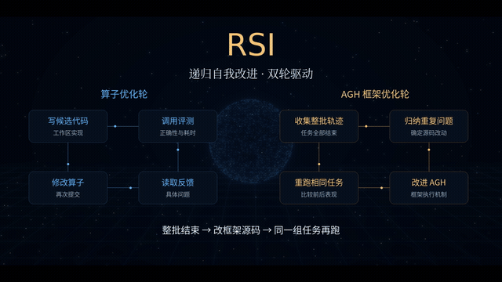

# KernelEvolve

English | [简体中文](README.zh-CN.md)

Two fused GPU operators and an agent-facing evaluation workflow for iterative kernel optimization.

## 1. Project overview

GPU workloads can spend substantial time moving intermediate results and launching many small operations. KernelEvolve provides two concrete implementations that fuse work around their data access patterns, together with tools for submitting a candidate and reading validation feedback.

- **CSR gather and sum:** aggregate graph-neighbor features using a schedule split by node degree.
- **Small-M matrix operation:** a Triton implementation for small row counts with FP32 accumulation.
- **Optimization workflow:** connect AGH to a project-specific evaluator so a candidate can be submitted, checked and refined.

This repository contains the project operators, benchmark code and plugin; AGH and any RSI framework are external. The standalone graph benchmark and plugin evaluation tasks are distinct paths.

## 2. Demo video

[](presentation/kernel-evolve.mp4)

[Watch the full demonstration](presentation/kernel-evolve.mp4) · [Open the presentation](presentation/index.html)

The demo presents the operator optimization loop and its feedback.

## 3. Architecture

```text
Problem and candidate kernel
       │
       ├── standalone benchmark ── correctness and timing
       │
       └── AGH plugin ── evaluation service ── job and feedback
                                  │
                           revise candidate
```

| Implementation | Design and entry point |
| --- | --- |
| Graph aggregation | [csr_gather_sum.py](operators/graph/csr_gather_sum.py): FP32 features of width 128; int64 indices and offsets; schedules degree ≤8, 9–32 and >32 separately |
| Small-M | [kernel.py](operators/small_m/kernel.py): FP16 inputs/outputs, FP32 accumulation, supported M values 1, 2, 4 and 8 |
| Evaluation backend | `kernel_lab` manages tasks, submissions and feedback |
| Agent tools | [kernel-workflow](plugins/kernel-workflow) exposes the project workflow to AGH |

For the small-M operator, `ModelNew()(a, b)` returns a tuple. More on measurements and task setup: [BENCHMARKING.md](BENCHMARKING.md) and [plugin flow](docs/plugin-flow.md).

## 4. Integration standards

### Run the operators

The documented environment uses Python 3.11, PyTorch 2.5.1 with CUDA 12.1 and Triton 3.1.0. Generate benchmark plans first, then execute on a compatible GPU:

```bash
python3.11 -m venv .venv
source .venv/bin/activate
pip install torch==2.5.1 --index-url https://download.pytorch.org/whl/cu121
pip install triton==3.1.0 numpy scipy
python benchmarks/run.py --operator graph --out outputs/graph-plan.json
python benchmarks/run.py --operator small-m --out outputs/small-m-plan.json
python benchmarks/run.py --operator graph --execute --gpu 0 --out outputs/graph-gpu.json
python benchmarks/run.py --operator small-m --execute --gpu 0 --out outputs/small-m-gpu.json
```

The plan specifies correctness and timing cases; executing it needs the CUDA device and produces result files under `outputs`.

### Connect the agent

The plugin `@kernel-lab/kernel-workflow` exposes `kernel_get_task`, `kernel_submit`, `kernel_get_job`, `kernel_get_task_status` and `kernel_read_feedback`. The evaluation backend is separate from the AGH runtime. Configure a run and start the evaluator:

```bash
python tools/configure_kernel_tools.py --run-id optimize_001
export KERNEL_TOOLS_CONFIG="$PWD/outputs/kernel-tools.json"
python -m kernel_lab baseline --run optimize_001 --tasks K12
python -m kernel_lab serve-evaluator --run optimize_001 --gpu 0 --keep-alive
```

Keep the evaluator running in its own terminal and configure the separately installed AGH runtime to use [plugins/kernel-workflow](plugins/kernel-workflow). The packaged workflow includes tasks K12 and K19; the graph operator also has its own standalone benchmark. See [plugin flow](docs/plugin-flow.md), [dependencies](DEPENDENCIES.md) and [LICENSE](LICENSE).
