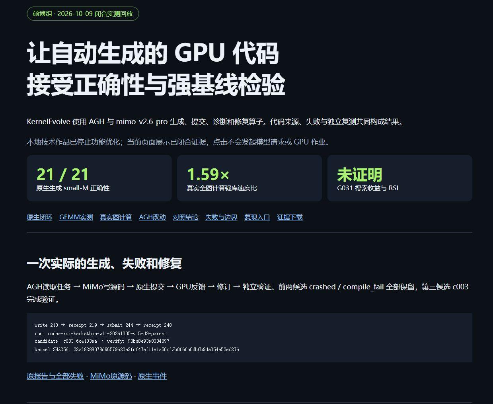
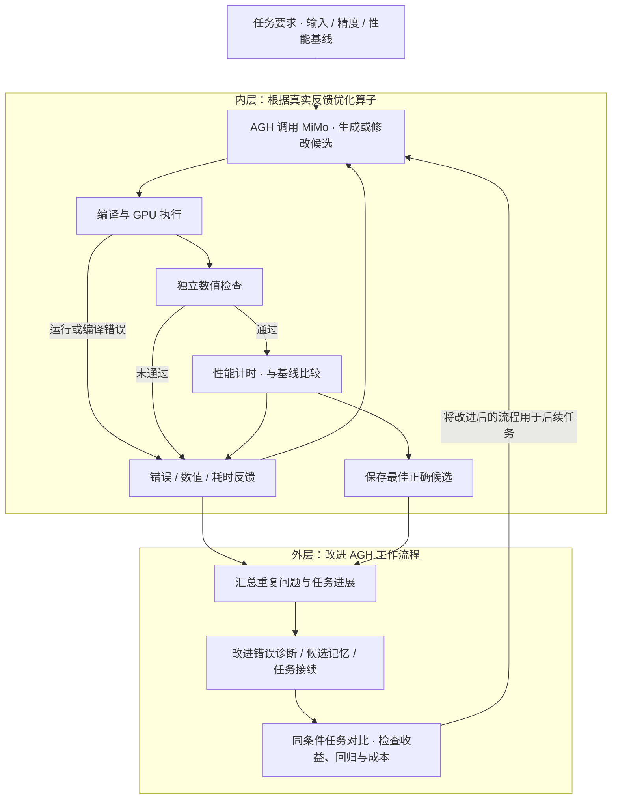

# KernelEvolve

**GPU 算子优化 · 让每次运行反馈成为下一次改进的依据**

面向 GPU 算子优化的智能体工程项目。基于 Agnes Harness（AGH），将候选代码生成、真实编译、数值检查、性能计时与反馈修正连接起来；同时改进错误诊断、候选记忆和任务接续，让下一轮优化能够利用已有进展。

> **“请优化这个小矩阵乘法：保持原有计算和精度要求，先验证结果，再比较速度，并保留最快的正确候选。”**

[查看演示](#结果工作台) · [了解系统](#系统如何工作) · [实验结果](#实验结果) · [开始复现](#开始复现) · [完整安装指南](SOURCE_INSTALL.md) · [来源与许可](#来源与许可)

2026 年江苏省 AI+科学与工程创新实践黑客松高校组参赛项目 · 东南大学 · ChatGPTeam · G004

## 结果工作台



工作台集中展示保存的原生任务事件、候选代码、正确性结果、计时样本与图计算复测。上图和本地页面展示的是**项目保存的运行记录**，便于逐步理解优化过程；打开页面即可阅读，无需先配置模型服务或 GPU。

## 这个项目解决什么问题

算子可以理解成模型反复使用的计算零件，例如矩阵乘法、归一化和图聚合。同一道计算题，代码如何组织线程、复用数据和处理浮点累加，都会影响 GPU 的实际速度。

让 AI 写出一份代码只是起点。它还需要通过三道关：**能运行、算得对、跑得快**。尤其面对小矩阵或特殊输入尺寸，通用写法未必适合当前任务。KernelEvolve 将真实错误、数值差异与耗时交回智能体，让下一次修改有具体依据。

| 能力 | 在项目中的作用 |
| --- | --- |
| 原生模型任务 | AGH 读取任务要求，调用模型编写和修改 GPU 候选代码 |
| 真实执行反馈 | 专业执行器完成编译、独立数值检查与 GPU 性能计时 |
| 错误诊断 | 保留错误类别与修复关注点，帮助后续尝试调整策略 |
| 候选记忆 | 持久保存已验证的正确候选，便于回退和继续优化 |
| 受控接续 | 在输出中断或后台作业未结束时，继续已有任务进度 |
| 应用验证 | 将优化放回完整图计算路径，检验局部收益能否转化为应用收益 |

项目希望回答两个问题：**当前算子怎样写得更好？完成这类任务的流程，怎样在下一轮少走弯路？**

## 系统如何工作

算子候选生成与反馈分析使用 **MiMo-V2.6-Pro**，API 请求名为 `mimo-v2.6-pro`。AGH 负责组织模型会话、工具调用与任务状态；编译器、独立检查程序和 GPU 执行器提供实际结果。



**内层改算子，外层改流程。** 内层形成代码与执行反馈之间的循环；外层从任务中反复出现的问题出发，改进 AGH，再放回任务中比较。这是面向递归自我改进（RSI）的工程探索，这些机制结合 AI 辅助开发，持续改进的效果还需要在独立新任务中检验。

专业工具通过 `kernel_get_task`、`kernel_submit`、`kernel_get_job` 和 `kernel_read_feedback` 串联任务、候选、作业与反馈。团队负责问题定义、验证标准、系统集成和最终取舍；模型负责提出候选并分析反馈。

### 从两次失败到正确运行

小矩阵乘法演示保留了一次连续修复：先修正内核调用方式，再根据矩阵指令要求将计算块调整为 `BLOCK_M = 16`，并用 `offs_m < M` 屏蔽不存在的输入行。最终候选通过 **21 项独立数值检查**。

这个例子说明，报错可以直接推动下一次实现修改。性能优化还需要考虑数据分块复用、减少中间结果读写，以及累加与舍入方式；因此项目始终先核对数值，再比较耗时。

## 实验结果

| 验证对象 | 比较方式 | 项目记录的结果 |
| --- | --- | --- |
| 五类 GPU 算子 | 相对各自原任务基线 | 约 **1.48–4.27×** |
| K12 小矩阵乘法 | 相对精度合格的强库实现，两张 GPU 独立复测 | 整体速度比约 **1.03× / 1.05×** |
| 完整图计算 | 相对同一计算路径下的合格库最快实现 | 两张 GPU 均约 **1.59×** |
| 20 项任务：完成评测 | 相同任务与固定预算，G014 / G030 对比 | **13 → 18** |
| 20 项任务：结果正确 | 同上，独立统计正确性 | **7 → 8** |
| 20 项任务：取得提速 | 同上，独立统计性能收益 | **3 → 4** |

不同任务和基线的倍率分别解释：原任务基线上的收益不等于对成熟强库的优势，小矩阵强库比较尚未达到预设统计胜出条件。20 项任务对比记录了流程推进方面的积极变化，尚不足以证明稳定的总体性能提升；G031 是经过工程验证的交付版本。

图计算使用 ogbn-arxiv 的 **169,343 个节点、1,166,243 条边**，验证固定未训练权重与条件化输入下的两层计算。约 1.59× 对应预先定义的 GPU 计算区间，预处理与编译不包含在该区间内；它不代表训练或分类精度提升。两张复测设备均为 RTX 4090。

仓库提供 K12、K19 任务包，以及 K12 和图应用的独立复测入口；20 项任务表格是历史对照结果，完整套件重跑需要补齐其他任务包。

保存的 [K12 原生追溯](demo/evidence/original-native-MiMo-small-M-actual-source-trace-verification-r1.json)、[图计算复测](demo/evidence/final-independent-citation-graph-two-device-actual-reproduction-r1.json) 与 [20 项任务对比](demo/evidence/g030-v50-original-two-arm-public-all40-r1.json) 可在工作台及结果文件中查看。

## 开始复现

### 第一步：查看保存的结果

需要 Python 3 与现代浏览器。这一步使用 Python 标准库，无需 API Key 或 GPU。

```bash
git clone https://github.com/sevenboom77/Kernel_Evolve.git
cd Kernel_Evolve
python3 -m http.server 8090 --bind 127.0.0.1 --directory demo
```

浏览器打开 `http://127.0.0.1:8090/`，查看候选、反馈和保存的复测结果。

### 第二步：在 Linux 上复测 GPU 结果

原实测环境为 **Linux、Python 3.11.10、PyTorch 2.5.1+cu121、Triton 3.1.0、CUDA 12.1、NVIDIA RTX 4090**。准备 NVIDIA 驱动及可用的 CUDA 环境后，按 [完整安装指南](SOURCE_INSTALL.md) 安装计算依赖：

```bash
python3.11 -m venv .venv
.venv/bin/python -m pip install torch==2.5.1 --index-url https://download.pytorch.org/whl/cu121
.venv/bin/python -m pip install triton==3.1.0 numpy scipy
.venv/bin/python -c 'import torch, triton; print(torch.__version__, triton.__version__, torch.cuda.is_available())'
```

先获取原始图数据并校验 SHA256，再生成复测计划。K12 独立复测不需要该数据集。以下 `/tmp/` 输出目录应使用新的路径。

```bash
# 获取图数据（约 83 MB；独立校验，不进入 Git 历史）
python3 scripts/fetch_release_assets.py --dataset

# 生成计划，不启动 GPU 计时
.venv/bin/python -B harness-evolution/competition/reproduce_native_small_m_fp32_reduction.py --out /tmp/kernel-evolve-native-plan
.venv/bin/python -B harness-evolution/competition/reproduce_citation_graph.py --archive datasets/arxiv.zip --out /tmp/kernel-evolve-graph-plan --case all

# 确认 CUDA 可用后，在空闲设备上实际复测
.venv/bin/python -B harness-evolution/competition/reproduce_native_small_m_fp32_reduction.py --out /tmp/kernel-evolve-native-gpu --execute --gpu 0
.venv/bin/python -B harness-evolution/competition/reproduce_citation_graph.py --archive datasets/arxiv.zip --out /tmp/kernel-evolve-graph-gpu --execute --gpu 0 --case all
```

复测入口保存输入、候选、正确性与性能输出，并遵循共享 GPU 锁及原评测协议。已有候选的独立复测不需要模型调用；如需开展新的候选搜索，则需要配置自己的模型授权和 AGH 专业工具。当前提供原环境与复测入口，全新机器的完整安装仍需按实际环境验证。

### 第三步：构建 AGH 并接入新任务

G031 固定源码已直接展开到 `third_party/agnes-harness/`，可以浏览和构建。原构建环境为 **Node.js 24.21.0、pnpm 10.34.5**，构建器要求绝对输出路径。

```bash
KERNEL_EVOLVE_ROOT="$(pwd -P)"
cd "$KERNEL_EVOLVE_ROOT/third_party/agnes-harness"
pnpm install --frozen-lockfile
pnpm --filter @agnes/cli build:local --output-dir "$KERNEL_EVOLVE_ROOT/runtime-new"
cd "$KERNEL_EVOLVE_ROOT"
node runtime-new/agnes.mjs --help
```

专业插件位于 [kernel-workflow-plugin](harness-evolution/kernel-workflow-plugin/)。账户配置、启动检查和新模型任务的接入说明见 [SOURCE_INSTALL.md](SOURCE_INSTALL.md)；模型服务授权使用你自己的账户。

## 源码导航

| 路径 | 从这里了解什么 |
| --- | --- |
| [demo](demo/) | 结果工作台、原生事件与保存的复测结果 |
| [demo/sources](demo/sources/) | 小矩阵候选、图计算实现与 G031 补丁 |
| [demo/evidence](demo/evidence/) | 算子追溯、图计算复测与流程对比 |
| [harness-evolution/kernel-workflow-plugin](harness-evolution/kernel-workflow-plugin/) | 任务、候选、作业查询与反馈工具 |
| [harness-evolution/competition](harness-evolution/competition/) | 独立复测、计算应用和运行验证入口 |
| [third_party/agnes-harness](third_party/agnes-harness/) | 可直接浏览和构建的 G031 完整固定源码 |
| [agh/g000](agh/g000/) · [agh/g014](agh/g014/) · [agh/g031](agh/g031/) | 历史源码版本的许可与 NOTICE；归档通过 Release 获取 |
| [datasets](datasets/) · [发布附件](https://github.com/sevenboom77/Kernel_Evolve/releases/tag/v0.1.0) | 图数据、历史源码快照及校验信息 |
| [SOURCE_INSTALL.md](SOURCE_INSTALL.md) | 环境、构建、启动与复测命令 |

## 来源与许可

- 基于 **Agnes Harness（AGH）**，固定源码归档保留原有 [Apache-2.0 许可证](agh/g031/LICENSE) 与 [NOTICE](agh/g031/NOTICE)；其他版本的许可保留在各自目录。
- 原生算子候选生成与反馈分析使用 **MiMo-V2.6-Pro**。AGH 补丁、图计算应用及独立复测脚本使用 Codex 辅助开发；团队负责方案选择、系统集成、实验验证与成果审核。
- PyTorch、Triton、CUDA、NumPy、SciPy 及其他依赖遵循各自许可与使用条件。
- 图数据来自 [Open Graph Benchmark 的 ogbn-arxiv](https://ogb.stanford.edu/docs/nodeprop/#ogbn-arxiv)，保留数据来源与 ODC-BY 条款记录；固定权重和条件化输入用于计算验证。
- 上游固定版本、改动范围见 [UPSTREAM.md](UPSTREAM.md)；发布目录与记录路径脱敏说明见 [PUBLICATION_NOTES.md](docs/PUBLICATION_NOTES.md)。
- 各组件保留已有版权、许可证与通知。本仓库未声明覆盖全部自有代码与材料的统一许可证，具体使用以相应文件和上游条款为准。

下一步将优先服务固定形状推理、图聚合与稀疏计算，用未参与开发的新任务比较正确性、速度、性能回归与总调用成本，让反馈、记忆和接续逐步成为可复用的优化能力。
