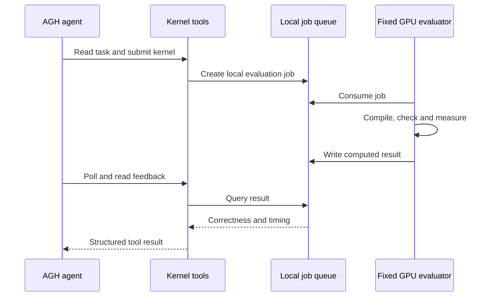

# AGH plugin and local evaluation

The plugin in `plugins/kernel-workflow/` registers five tools:

| Tool | Role |
|---|---|
| `kernel_get_task` | Read a task and its numerical requirements |
| `kernel_submit` | Submit a candidate directory containing `kernel.py` |
| `kernel_get_job` | Poll a submitted evaluation |
| `kernel_get_task_status` | Inspect candidates, budget and current selection |
| `kernel_read_feedback` | Read correctness, compilation and timing feedback |

AGH runs the model and invokes the tools. The fixed `kernel_lab` backend executes submitted candidates and computes the results. The backend is supplied so these tools have a runnable local implementation.

## Configuration

Use Node.js 24.10 or later and pnpm 10.34.5. The compatible interface is the project's G031 snapshot of [Agnes Harness](https://github.com/AgnesAI-Labs/agnes-harness), recorded as commit `12e3b131e405295805caa3daa90f4c2b827cbed4`. G031 is a project snapshot label, not a published package version; that commit is not assumed to be available in the public upstream repository. The fixed source remains available in the [v0.1.0 G031 archive](https://github.com/sevenboom77/Kernel_Evolve/releases/download/v0.1.0/agh-g031-source.tar.gz).

In the KernelEvolve repository root, with the project's Python environment active:

```bash
export KERNEL_EVOLVE_ROOT="$(pwd -P)"
python tools/configure_kernel_tools.py --run-id optimize_001
export KERNEL_TOOLS_CONFIG="$KERNEL_EVOLVE_ROOT/outputs/kernel-tools.json"
```

The configuration records the Python interpreter, repository root and run ID. Keep `KERNEL_TOOLS_CONFIG` exported in the terminal that starts AGH. It must be set before the AGH daemon starts.

## Install the compatible AGH runtime

Download and build the snapshot in a separate directory on Linux. The archive SHA256 is `f168de0abb4808053906298419dd3166aec82e29946c4eaf4468535a75825529`.

```bash
mkdir -p "$HOME/kernel-evolve-deps"
cd "$HOME/kernel-evolve-deps"
curl -fL -o agh-g031-source.tar.gz \
  https://github.com/sevenboom77/Kernel_Evolve/releases/download/v0.1.0/agh-g031-source.tar.gz
echo 'f168de0abb4808053906298419dd3166aec82e29946c4eaf4468535a75825529  agh-g031-source.tar.gz' | sha256sum -c -
mkdir agh-g031
tar -xzf agh-g031-source.tar.gz -C agh-g031
export AGH_SOURCE_ROOT="$PWD/agh-g031"
cd "$AGH_SOURCE_ROOT"
pnpm install --frozen-lockfile
pnpm --filter @agnes/cli build:local
export AGH_ENTRY="$AGH_SOURCE_ROOT/packages/cli/dist/local/agnes.mjs"
```

Use an isolated AGH instance and the same environment for installation and startup:

```bash
export AGH_HOME="$(mktemp -d /tmp/agh-kernel.XXXXXX)"
export AGNES_PROFILE=local-dev
cd "$KERNEL_EVOLVE_ROOT"
node "$AGH_ENTRY" package inspect "file:$KERNEL_EVOLVE_ROOT/plugins/kernel-workflow"
node "$AGH_ENTRY" install "file:$KERNEL_EVOLVE_ROOT/plugins/kernel-workflow"
```

After installation, use the actual `integrity` and `capabilityHash` returned by inspection in place of `INTEGRITY` and `CAPABILITY_HASH`:

```bash
node "$AGH_ENTRY" package trust @kernel-lab/kernel-workflow INTEGRITY CAPABILITY_HASH
node "$AGH_ENTRY" package enable @kernel-lab/kernel-workflow
node "$AGH_ENTRY" package status
node "$AGH_ENTRY" serve
```

Configure your model account in this same AGH instance, following the runtime's account guide. This repository supplies no model credentials. The commands above were checked against the snapshot's CLI; a complete model/GPU session was not rerun for this source update.

## Evaluate candidates

Before submitting work, enqueue the baselines and start a local evaluator as described in [BENCHMARKING.md](../BENCHMARKING.md). Ask the agent to read K12, inspect `operators/small_m/kernel.py`, submit a candidate, and use the returned job ID to read its results.

The graph-fusion module is also directly callable through its Python API and the standalone benchmark. The five plugin tools use the packaged K12/K19 task interface; the graph demonstration uses its own CSR input interface.

The plugin's no-model budget and workspace checks run with:

```bash
node --test plugins/kernel-workflow/budget.test.mjs
```

After configuring Python dependencies and the run, `node plugins/kernel-workflow/smoke.mjs` checks tool registration and the real CLI read path for K12. It does not execute a model or measure a GPU kernel.

## Data flow


