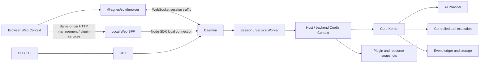

# Architecture: from a request to recoverable execution

English | [简体中文](architecture.zh-CN.md)

[Documentation](../README.md) · [Source map](source-map.md)

AGH runs tasks in a shared backend so CLI, Web, and SDK work with the same session state. Business tools and interfaces use distinct extension entry points and can be developed separately, then composed into an application. This guide follows a request through that architecture.

Clients present state, the daemon manages sessions and the control plane, Host assembles the runtime, and Core advances the model/tool loop. Models propose actions; model text does not decide tool authorization, execution, or persistent state.

## Brain, cerebellum, memory and body

**LLM is the brain, Jev is the cerebellum, Harness is the memory, and MHS is the body.** This is a role metaphor for the product vision, and the overview shows the target architecture; the request diagram below follows the existing software implementation.

| Concept | Responsibility and implementation boundary |
| --- | --- |
| **LLM / brain** | The [AI provider layer](../../packages/ai/src) supplies model inference. Core consumes proposed actions through the controlled execution flow. |
| **Jev / cerebellum** | A planned structured-decision integration for routing, scoring, and execution coordination. Main uses the built-in [Core loop](../../packages/core/src/step/session.ts); it has no Jev adapter or Jev-driven loop. [TypeSafe's Jev guide](https://docs.typesafe.ai/introduction/coding-agents) explains its structured-decision role. AGH's integration contract still needs implementation and validation. |
| **Harness / memory** | [Core event records](../../packages/core/src/log), task state, shared sessions, and recovery preserve task context. [Skills](../guide/skills.md) capture reusable methods. Harness also owns execution and governance; these memory mechanisms preserve facts and methods under their existing contracts. |
| **MHS / body** | A planned device capability interface, built on MCP (Model Context Protocol) rather than a vendor-specific SDK or a ROS bridge: AGH would organize state reads, action requests, and receipts through MCP-based adapters. The physical body consists of devices and their controllers; AGH's [MHS integration](../guide/mhs.md) is exploratory. |

Jev decisions and LLM proposals would still pass through backend authorization and execution controls. Session records and Skills contribute context; authority comes from the configured policy and approval flow.

## Runtime request path

## The two Web communication paths

The session path is `@agnes/sdk/browser` → WebSocket → daemon. `app.ts` reads the address from the page's `agnes-config` `data-ws` attribute and creates a client with `transport.kind: 'ws'`, protocol `agnes-v1`, and `auth.kind: 'local'`. Session creation/loading, prompts, events, and approvals use this connection without HTTP BFF forwarding. `local` does not waive server-side loopback, Origin, or permission checks.

Management and constrained plugin services use a same-origin HTTP BFF. Resource management uses `/admin/resources/api/...`; client plugin queries/effects use `/api/client-modules/service` and `/api/client-modules/effect`. The local Web process then calls the daemon through the Node SDK's local connection. Direct browser session connectivity does not give browser plugins Node management capabilities. `ClientContext` service relay remains constrained by the current session, row identity, and allow-list.

Code: [browser session client](../../packages/web/src/app.ts), [browser SDK exports and management restrictions](../../packages/sdk/src/index.browser.ts), [resource-management BFF](../../packages/resource-control-cli/src/admin-bff.ts), [plugin-service BFF](../../packages/cli/launch/package-admin.ts), [Web server](../../packages/web-server/src/server.ts).

## State ownership

| Layer | Main responsibilities |
| --- | --- |
| CLI/Web | User input, approval interaction, sessions, and result presentation |
| SDK | Protocol, transport, session handles, cursors, and request journal |
| daemon / worker | Shared instance and session directory, control plane, and approval routing; workers host execution environments |
| Host | Profiles, credentials, platform adapters, plugin assembly, and Kernel creation |
| Core | Execution state machine, event facts, and required capability seams |
| AI/Base/Code | Provider protocols, standard capabilities, and programmable workflows |

A prompt reaches the daemon through the SDK and is routed to a session worker. Host supplies model, tool, approval, sandbox, storage, and other seams for that session. Core generates the next step, records state, and consumes model or tool results. Clients read events or derived projections. Backend state determines cancellation, failure, parking, and recovery.

When a tool text block is a complete JSON object or array matching its structured result, Core removes JSON whitespace outside strings from the model view. Original ledger content, number literals, duplicate keys, strings, and escapes remain unchanged. Other text retains its formatting. The existing untrusted wrapping, sanitization, historical nonce selection, and request hashing apply to the resulting view for both turns and summaries.

## Seams and extensions

Core retains bounded DEV kernel evaluation state for `kernel_submit` / `kernel_get_job` workflows. A successful, unmodified submission receipt and a validated terminal candidate result produce ignorable system events in the same commit as their ordinary tool results. Identity checks bind the task, job, candidate and complete source hash to the current session, lane, workspace, turn and tool-registry snapshot; foreign jobs, held phases, contamination and replaced hook results contribute no memory. Each later primary request derives a `[kernel search state]` note from the durable observations, with at most four source outcomes and 2048 UTF-8 bytes. Failed compilation suggests inspecting its diagnostic, numerical failure suggests repairing correctness, and a runtime crash or timeout retains its failure status and suggests inspecting that cause first. Runtime failures may have no correctness counts and do not assert numerical correctness. A correct DEV result permits performance work. Replay and context compaction rebuild that state from the ledger. These facts do not establish final acceptance, alter submissions or numerics, inherit candidates into another turn, or add inference/evaluation calls; the request hook retains its existing final say. Correct DEV outcomes can also retain a positive finite observed speedup and genuine boolean measurement-floor/launch-bound warnings; absent warnings are not assumed false. The bounded projection keeps the best observed correct source and the latest source, references that retained row by index, and suggests comparing a slower correct revision or changing strategy for an observed slowdown. These noisy DEV measurements are search hints only: no official champion, score or final acceptance changes. Invalid JSON-compatible metrics preserve the correctness fact; non-JSON tool results retain the original rejection contract.

An authenticated incorrect DEV observation may also retain an optional `numerical_failure_class`. The classifier accepts only bounded, anchored standard `first_failures[].problems` diagnostics; it never evaluates Python expressions or stores diagnostic text, coordinates or values. Scale and sparse pointwise categories require evidence from at least two distinct failed cases; output shape, dtype or arity diagnostics can identify a contract mismatch directly. Unknown formats and mixed categories give no class. The first authenticated classified incorrect DEV source already receives the corresponding bounded repair focus: check sum/mean and reduction normalization, check reference arithmetic/cast boundaries and the original per-coordinate tolerance, or repair the output contract. Two distinct source hashes repeating the latest category additionally suggest changing repair strategy; a first failure is not labeled a repeated failure. The global `max_tol` is not the tolerance at a failing coordinate. This optional schema-version-1 field preserves older events; unknown values are ignored, duplicate hashes do not establish repeated failures, and a corrected latest source clears the repair focus. Categories are hypotheses for the next search step, not mathematical root-cause claims or acceptance changes.

An incorrect observation can additionally retain a `numerical_failure_fingerprint`: SHA256 over every bounded standard diagnostic, sorted by case and problem, together with the correctness counts. Free text, invalid/nonfinite numeric diagnostics, duplicate case identifiers or exceeded limits produce no fingerprint; original diagnostic text is never persisted in this field. Two different source hashes with the same fingerprint suggest changing the numerical repair strategy even when no error category was inferred. The note preserves an existing category-specific repair focus when both kinds of repetition apply. Polling the same job or source does not create repetition, and a corrected or changed latest diagnostic clears the exact-repeat suggestion. This optional schema-version-1 field retains older events, the four-fact/2048-byte note boundary, scope/trust checks, tool authorization and the original acceptance rules. Equality describes an observed repeated failure, not its mathematical cause.

When a primary native kernel response reaches its output limit, Core can checkpoint once with `need_assistant` if that request actually disclosed `kernel_get_task`, `kernel_submit` and `kernel_get_job`, a durable provider-request cap has remaining allowance, and the turn is not cancelled. A trusted, ignorable `x/core/output-limit-continuation` event binds the recovery to the current session, lane, workspace, turn and registry snapshot. Replay, a second truncation, or a trusted current-turn marker with a changed scope cannot grant another recovery. Untrusted markers and other lanes cannot affect this decision. All truncated tool calls remain discarded; partial text, costs and request admissions remain recorded. The continuation requests shorter complete calls without raising output, step, request or candidate limits, and the next dispatch still passes ordinary admission. Uncapped, exhausted, undisclosed and ordinary workflows retain `OUTPUT_LIMIT` termination; compaction behavior is unchanged.

A seam supplies a required part of execution, such as approval, ledger, or sandbox behavior. Missing seams must be refused according to the contract rather than silently skipped. Extensions contribute optional features such as tools, observation hooks, or client slots. Both can be assembled through Cordis, but they have different permission surfaces.

Trusted backend Cordis rows may contribute tools, hooks, and constrained services. A browser module is a separate runtime surface bound to a row; see [plugin boundaries](plugins.md). Frontend and backend Contexts do not share memory. Ordinary `ctx.provide()` is not a cross-process proxy. Browsers call row services through declared relays without obtaining Host management objects.

## Runtime targets and hot updates

PackageManager produces verified snapshots and governance state. A runtime target combines ordinary rows, resource rows, and platform-synthesized client rows. `web:` rows do not execute in Host's ordinary tree. Host reconciles mutable rows, dependencies, and actual state in constrained transactions, applying eligible changes incrementally. Static boundaries, failed compensation, or tainted state may require a rebuild.

This supports incremental updates for eligible changes. Transactions do not cover external business effects. The frontend also reconciles its own roster and cleans up fibers, so inspect both backend actual state and page loading.

## MCP and Skills

The MCP control plane stores definitions, trust, and enablement. Session workers mount a Host `ext:` row per eligible server from resource snapshots. Startup and turn-boundary reloads use the same apply path; the dedicated resource-management service worker uses the manager. The session path currently skips OAuth bindings; see [MCP runtime behavior](../guide/mcp.md#runtime-behavior-and-versions) for the call chain and limits.

Skills combine disk/package resource governance with runtime Cordis contributions. The shared worker handles Skill scan/deletion commands, and Host's Skills row can refresh incrementally after resource changes. The session workspace determines visible disk Skills. This lifecycle differs from per-server MCP rows; do not assume each Skill source has its own Host row.

## App Server and clients

AGH's App Server provides shared task execution: the daemon manages sessions and the control plane, workers execute tasks, and the SDK provides communication entry points. Choose an integration path from the repository's [API contracts](../reference/api.md) when building a client.

## Scope of reusable applications

FDE is a delivery approach; MHS is a device integration direction. An FDE deployment can use AGH's existing extension paths for enterprise software and can later include device integrations. Knowledge retrieval, database connectors, business systems, and specialized interfaces require implementation and validation for each environment.

| Module and source ownership | FDE use through current software paths | Reusable foundation for a future MHS integration |
| --- | --- | --- |
| App Server: [SDK](../../packages/sdk/src), [daemon](../../packages/daemon/src), [worker](../../packages/worker-runtime/src) | Shared sessions, task submission, events, approval routing, and client integration | Task entry points, human confirmation, and status presentation |
| Agent Loop: [Host assembly](../../packages/host/src/assemble.ts), [Core](../../packages/core/src), [AI](../../packages/ai/src) | Model/tool execution, task state, interruption handling, and recovery | High-level device task orchestration; device controllers perform actual motion |
| Memory: [event records](../../packages/core/src/log), [resource governance](../../packages/resource-control-runtime/src) | Preserve task history and results; reuse methods through Skills | Preserve observations and adapter receipts under task-record contracts; device truth needs device-side verification |
| Execution constraints: [controlled tool execution](../../packages/core/src/step/tools.ts), [sandbox](../../packages/base/src/sandbox-shell.ts), [workspace policy](../../packages/host/src/workspace-policy.ts) | Tool approvals and applicable software execution constraints | Software-side control points; device interlocks, emergency stops, and local takeover remain device responsibilities |
| Plugins: [Cordis](../../packages/cordis/src), [plugin runtime](../../packages/plugin-runtime/src), [package manager](../../packages/package-manager/src), [Web client modules](../../packages/web-client/src) | Backend tools/services, hooks, Skills, MCP connections, and business panels | Extension points for adapters and device-facing interfaces; no verified general-purpose MHS adapter exists in this repository |

Ordinary backend plugins execute as trusted in-process code. A tool approval or available command sandbox does not isolate arbitrary plugin code. Approvals, sandbox behavior, and other required seams are selected by trusted deployment configuration; ordinary extensions do not acquire the right to replace them by registering a tool or hook. See [security and trust](../guide/security.md).

MHS adapters are the device branch in the overview, built on MCP (Model Context Protocol) rather than a vendor-specific SDK or a ROS bridge. Integration guides and examples are [coming soon](../guide/mhs.md); a bare MCP connection alone does not establish MHS compatibility, since no public MHS specification is open for certification. Task cancellation does not establish that a physical device stopped safely. Enterprise deployment, audit, isolation, and device actions each need validation in their actual environment.

Source: [Host](../../packages/host/src/assemble.ts), [Worker](../../packages/worker-runtime/src/main.ts), [Core](../../packages/core/src), [Daemon](../../packages/daemon/src/supervisor/supervisor.ts), [runtime-target publication](../../packages/host/src/runtime-target-publisher.ts), [Web Context](../../packages/web/src/client-modules/boot.ts).
