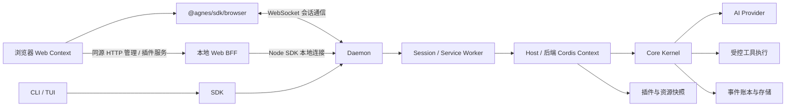

# 架构：从请求到可恢复执行

[English](architecture.md) | 简体中文

[文档导航](../README.zh-CN.md) · [源码地图](source-map.zh-CN.md)

AGH 把任务运行放在共享后台，让 CLI、Web 与 SDK 围绕同一份会话状态工作。业务工具和界面通过各自的扩展入口接入，开发者可以分别构建，再组合成应用。本页沿一次请求说明这套结构如何工作。

AGH 的客户端展示状态，daemon 管理会话与控制面，Host 组装运行环境，Core 推进模型与工具的执行循环。模型负责生成候选行为；工具授权、执行与持久状态不由模型文本决定。

## 大脑、小脑、记忆与身体

**LLM 是大脑，Jev 是小脑，Harness 是记忆，MHS 是身体。** 这是一组描述产品愿景的角色比喻，总览图展示目标架构；下方请求链路图对应当前软件实现。

| 概念 | 职责与实现边界 |
| --- | --- |
| **LLM / 大脑** | [AI Provider 层](../../packages/ai/src)提供模型推理；Core 通过受控执行流程处理候选动作。 |
| **Jev / 小脑** | 规划中的结构化决策接入，用于路由、评分和执行协调。main 使用内置 [Core loop](../../packages/core/src/step/session.ts)，没有 Jev 适配器或 Jev 驱动的 loop。[TypeSafe 的 Jev 说明](https://docs.typesafe.ai/introduction/coding-agents)介绍其结构化决策角色；AGH 的接入合同仍需实现与验证。 |
| **Harness / 记忆** | [Core 事件记录](../../packages/core/src/log)、任务状态、共享会话与恢复机制保存任务上下文；[Skills](../guide/skills.zh-CN.md)沉淀可复用方法。Harness 同时承担执行与治理；这些记忆机制按现有合同保存事实与方法。 |
| **MHS / 身体** | 规划中的设备能力接口，基于 MCP（Model Context Protocol）而非厂商专属 SDK 或 ROS 桥接：AGH 通过基于 MCP 的适配器组织状态读取、动作请求和回执。物理身体由设备及其控制器组成；AGH 的 [MHS 接入](../guide/mhs.zh-CN.md)仍处于探索阶段。 |

Jev 的决策和 LLM 的候选动作都应经过后台授权与执行控制。会话记录和 Skills 提供上下文；权限由配置的策略与审批流程决定。

## 运行时请求链路

## Web 的两条通信路径

会话主路径是浏览器中的 `@agnes/sdk/browser` → WebSocket → daemon。`app.ts` 从页面 `agnes-config` 的 `data-ws` 读取地址，以 `transport.kind: 'ws'`、协议 `agnes-v1` 和 `auth.kind: 'local'` 创建客户端；会话创建/加载、prompt、事件和审批交互走这条连接。它不经过 HTTP BFF 转发；`local` 不表示可以免除服务端的回环/Origin 与权限校验。

管理及受限插件服务则走同源 HTTP BFF。资源管理使用 `/admin/resources/api/...`，客户端插件 query/effect 使用 `/api/client-modules/service`、`/api/client-modules/effect`；本地 Web 进程再用 Node SDK 的本地连接调用 daemon。浏览器有直接会话连接，不等于浏览器插件获得了 Node 管理能力；`ClientContext` 的 service relay 仍受当前会话、行身份和 allow-list 约束。

对应代码：[浏览器会话客户端](../../packages/web/src/app.ts)、[浏览器 SDK 出口与管理方法限制](../../packages/sdk/src/index.browser.ts)、[资源管理 BFF](../../packages/resource-control-cli/src/admin-bff.ts)、[插件服务 BFF](../../packages/cli/launch/package-admin.ts)、[Web 服务](../../packages/web-server/src/server.ts)。

## 状态归属

| 层 | 主要职责 |
| --- | --- |
| CLI/Web | 用户输入、审批交互、会话与结果展示 |
| SDK | 协议、传输、会话句柄、游标与请求日志 |
| daemon / worker | 共享实例与会话目录、控制面与审批路由；worker 承载执行环境 |
| Host | Profile、凭据、平台适配、插件装配与 Kernel 创建 |
| Core | 执行状态机、事件事实与必要能力接缝 |
| AI/Base/Code | 提供方协议、标准能力与可编程工作流 |

一次 prompt 经 SDK 到 daemon，路由到 session worker。Host 为该会话提供模型、工具、审批、沙箱、存储等接缝；Core 生成下一步、记录状态，再消费模型或工具结果。客户端读取事件或派生投影。取消、失败、停驻、恢复都由后台状态决定。

当工具文本块是与其 structured 结果一致的完整 JSON 对象或数组时，Core 仅从模型视图中移除字符串外的 JSON 空白。原账本内容、数值字面量、重复键、字符串和转义保持原样；其他文本保留格式。原有不受信任封套、清洗、历史 nonce 选择和请求哈希继续应用于该视图，普通轮次与摘要请求使用相同规则。

## 接缝与扩展

Core 为 `kernel_submit` / `kernel_get_job` 工作流保存有界的 DEV 算子评测状态。成功且未被覆盖的提交回执、经校验的终结候选结果，与原工具结果在同一提交中产生可忽略的 system 事件。身份校验把任务、job、candidate 和完整源码哈希绑定到当前 session、lane、workspace、turn 与工具注册表快照；其他任务、保留集阶段、污染结果和被 hook 替换的结果不会形成记忆。后续主模型请求从持久观察重建 `[kernel search state]` 注记，最多四个源码结果、2048 UTF-8 字节。编译失败提示检查诊断，数值失败提示先修正确性，运行崩溃和超时保留失败事实并提示先检查相应诊断；这两类结果可以没有正确性计数，不代表数值正确。DEV 正确后允许继续优化性能。重放和上下文压缩都从账本重建状态。这些事实不代表最终验收、不改变提交或数值、不跨 turn 继承候选，也不增加模型或评测调用；请求 hook 保持原有最终决定权。 正确 DEV 结果还可保存正有限的实测加速比和真实布尔测量下限、启动限制警告；缺失警告不推断为 false。有界投影保留观测较快的正确源码与最新源码，用索引指向实际保留行，并在正确新版本变慢时提示比较旧版本、低于基线时提示调整策略。这些带噪声的 DEV 测量仅作搜索线索，不改变正式冠军、评分或最终验收。JSON 兼容的错误指标不丢弃正确性事实，非 JSON 工具结果保持原整体拒绝合同。

原生算子工作流的主模型响应触到输出上限时，如果该请求实际披露了 `kernel_get_task`、`kernel_submit`、`kernel_get_job`，持久 provider 请求预算仍有余额且当前 turn 未取消，Core 允许一次 `need_assistant` checkpoint 续接。受信、可忽略的 `x/core/output-limit-continuation` 事件把恢复绑定到当前 session、lane、workspace、turn 与注册表快照；重放、第二次截断或当前 turn 受信标记的 scope 改变都不能再获恢复。不受信标记与其他 lane 不影响决定。半截工具调用仍全部丢弃，部分文本、原费用和请求准入记录保留。续接要求使用简短完整调用，不提高输出、步骤、请求或候选限额，下一请求仍经过原准入。无预算、预算耗尽、未披露和普通工作流保持 `OUTPUT_LIMIT` 终止，压缩行为不变。

Seam 是必要执行位置的实现，例如审批、账本、沙箱；缺失必须按合同拒绝，不能静默跳过。Extension 是可选贡献，例如工具、观察 hook、客户端槽位。它们虽可通过 Cordis 装配，但权限面并不相同。

受信后端 Cordis 行可贡献工具、hook 和受约束的服务等能力；浏览器模块是绑定该行的另一运行面，详见[插件边界](plugins.zh-CN.md)。前后端的 Context 不共享内存；普通 `ctx.provide()` 不是跨进程代理。浏览器通过已声明的 relay 调用行服务，不直接获取 Host 管理对象。

认证的错误DEV观察可在schemaVersion=1中保留可选的`numerical_failure_class`。分类只接受有界、完整匹配的标准`first_failures[].problems`诊断，不执行Python表达式，不保存原始文本、case编号、坐标或数值。尺度和稀疏坐标类别至少要求两个不同失败case，输出shape/dtype/arity可由明确合同诊断识别；缺失、未知或混合类别不产生提示。首个已认证且已分类的错误DEV源码即可获得对应的有界修复关注点：检查sum/mean及归约分母、参考运算顺序和中间舍入及原坐标容差，或修复输出合同。同一搜索的两个不同源码hash重复最新错误类别时，另外提示更换修复策略；首错不会被称为重复失败。全局`max_tol`不代表首错坐标的容差。旧事件继续有效，未知枚举忽略，同hash重复查询不计两次，最新正确结果清除修复关注点。类别只是下一步搜索假设，不是根因或验收结论，4事实/2048 UTF-8字节和原授权、调用、评分边界不变。

错误DEV观察还可保留可选`numerical_failure_fingerprint`：对按case和problem排序的全部有界标准诊断及正确性计数计算SHA256。不合法或非有限数值、自由文本、重复case或超限不生成指纹，该字段不保存诊断原文。两个不同源码hash出现同一指纹时，即使未识别类别，也提示更换数值修复策略；同时已有分类时保留对应的具体修复关注点。同job或同源重复查询不计两次，最新正确或诊断变化清除精确重复提示。schemaVersion=1兼容旧记录，四事实/2048字节、原scope/trust校验、授权和验收规则保持；相等仅描述重复失败，不证明数学原因。

## Runtime target 与热更新

PackageManager 产生已核验快照和治理状态；runtime target 组合普通行、资源行与平台合成的客户端行。`web:` 行不在 Host 普通树执行。Host 在受限事务中协调可变行、依赖和实际状态，合格变更增量应用；静态边界、失败补偿或污染处理可能要求重建。

这套机制支持符合条件的增量更新。其事务范围不覆盖外部业务效果；前端还有自己的名册对账与 fiber 清理，需要分别检查后端实际状态和页面加载结果。

## MCP 与 Skills

MCP 控制面保存定义、信任与启用状态。session worker 从资源快照为每个合格服务器挂载 Host `ext:` 行，启动与轮次边界重载使用同一条 apply 路径；专用资源管理 service worker 使用 manager。当前会话路径跳过 OAuth 绑定，具体调用链与限制见[MCP 运行方式](../guide/mcp.zh-CN.md#运行方式与版本)。

Skills 包含磁盘/包资源治理与运行时 Cordis 贡献。当前共享 worker 承接 Skill 扫描/删除命令，Host 的 Skills 行可在资源变化后增量刷新；会话工作区仍决定可见磁盘 Skill。它与 MCP 的逐服务器行是不同的生命周期，不应推定所有 Skill 来源都各有独立 Host 行。

## App Server 与客户端

AGH 的 App Server 为客户端提供共享的任务运行基础：daemon 管理会话与控制面，worker 承载执行，SDK 提供通信入口。开发自己的客户端时，从本仓的[API 合同](../reference/api.zh-CN.md)选择接入方式。

## 可复用场景的范围

FDE 是交付方式，MHS 是设备接入方向。FDE 交付可通过 AGH 已有扩展入口构建企业软件，后续也可包含设备接入。知识检索、数据库连接器、业务系统与专用界面需要针对具体环境开发与验证。

| 模块与源码归属 | 当前软件路径怎样支撑 FDE | 后续 MHS 接入可复用的底座 |
| --- | --- | --- |
| App Server：[SDK](../../packages/sdk/src)、[daemon](../../packages/daemon/src)、[worker](../../packages/worker-runtime/src) | 共享会话、任务提交、事件、审批路由与客户端接入 | 任务入口、人工确认和状态展示 |
| Agent Loop：[Host 装配](../../packages/host/src/assemble.ts)、[Core](../../packages/core/src)、[AI](../../packages/ai/src) | 模型与工具执行、任务状态、中断处理和恢复 | 高层设备任务编排；实际运动由设备控制器执行 |
| 记忆：[事件记录](../../packages/core/src/log)、[资源治理](../../packages/resource-control-runtime/src) | 保存任务历史和结果，通过 Skills 复用方法 | 按任务记录合同保存观察与适配器回执；设备实际状态仍需设备侧验证 |
| 执行约束：[受控工具执行](../../packages/core/src/step/tools.ts)、[sandbox](../../packages/base/src/sandbox-shell.ts)、[工作区策略](../../packages/host/src/workspace-policy.ts) | 工具审批与适用的软件执行约束 | 软件侧控制点；设备互锁、急停与本地接管仍由设备侧承担 |
| 插件：[Cordis](../../packages/cordis/src)、[插件运行时](../../packages/plugin-runtime/src)、[包管理](../../packages/package-manager/src)、[Web 客户端模块](../../packages/web-client/src) | 后端工具与服务、hooks、Skills、MCP 连接和业务面板 | 适配器与设备操作界面的扩展入口；仓库尚无已验证的通用 MHS 适配器 |

普通后端插件作为受信进程内代码执行；一次工具审批或可用的命令沙箱不代表任意插件代码已被隔离。审批、沙箱等必要接缝由受信部署配置选择；普通扩展注册工具或 hook 不会获得替换它们的权限。详见[安全与信任](../guide/security.zh-CN.md)。

MHS 适配器对应总览图中的设备分支，基于 MCP（Model Context Protocol）而非厂商专属 SDK 或 ROS 桥接；接入指南与示例[即将开放](../guide/mhs.zh-CN.md)。仅完成一次 MCP 连接本身不构成 MHS 兼容证明，因为目前没有可供认证的公开 MHS 规范；取消任务也不代表物理设备已安全停止。企业部署、审计、隔离与设备动作均需在实际环境中分别验证。

源码依据：[Host](../../packages/host/src/assemble.ts)、[Worker](../../packages/worker-runtime/src/main.ts)、[Core](../../packages/core/src)、[Daemon](../../packages/daemon/src/supervisor/supervisor.ts)、[运行目标发布](../../packages/host/src/runtime-target-publisher.ts)、[Web Context](../../packages/web/src/client-modules/boot.ts)。
